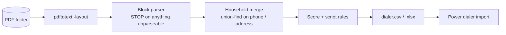

# policy-pdf-to-dialer

**Turn a stack of insurance "prior coverage" PDFs into a ranked, household-level dialer CSV in seconds instead of an hour of copy-paste.**

## The problem
A life insurance agency hands agents a daily book of existing-policyholder leads as PDFs: one summary per lead, often several policies per household, wrapped across pages, with glued-on source tags, dummy phone numbers, and inconsistent layouts. Agents were retyping these into the dialer by hand: slow, error-prone, and nobody picked the right call script consistently.

## What it does
**`parse_prior_coverage.py` – parse, merge, score, route.** Point it at a folder of PDFs (or extracted text).
   - Extracts name, age, DOB, phones, address, policy number, status (active/lapsed), annual premium, issue date, accidental riders, email.
   - **Never invents data.** An unparseable block stops the run with the file and reason.
   - Drops dummy phones, merges people into **households** (union-find on shared phone or street+zip).
   - Picks the primary contact and best phone, computes a lead score and household premium.
   - Chooses the **call script** by explicit rules (accidental rider + age, recent issue within 18 months, age band).
   - Writes `dialer.csv` (+ `dialer.xlsx`) sorted by score, plus `run-summary.json`.

## Architecture


## Run it
```bash
sudo apt-get install poppler-utils      # pdftotext
pip install -r requirements.txt
python3 parse_prior_coverage.py examples/input --out output --today 2026-01-15 --prefix DEMO
python3 -c "import sys;sys.path.insert(0,'tests');import test_parser as t;t.test_sample_book()"   # or: pytest
```

## Example output
Input: `examples/input/sample-prior-coverage.txt` (4 fictional policies, `555-01xx` numbers, `ZZ` state).
```
{"files": 1, "policies": 4, "households": 3, "no_phone": 0,
 "scripts": {"Under-65 Review + Recommended": 1, "Senior Review": 1, "Under-65 Review": 1}}
```
`examples/output/dialer.csv` (trimmed):

| Name | Mobile # | Other # | Lead Score | Household Premium | Active / Lapsed | Script Type | Members |
|---|---|---|---|---|---|---|---|
| Jane Q Sample | (555) 010-0101 | (555) 010-0199 | 77 | 612.40 | 1 / 1 | Under-65 Review + Recommended | Jane Q Sample (42); John Sample (44) |
| Alex Tester | (555) 010-0202 | | 64 | 744.00 | 1 / 0 | Senior Review | Alex Tester (63) |
| Sam Demo | (555) 010-0303 | | 55 | 298.80 | 1 / 0 | Under-65 Review | Sam Demo (29) |

Note Sam's primary phone was `(000) 000-0000`, so the secondary became the dial number.

## In production
The original version of this ran on a real daily lead book and replaced manual entry for a sales team. This repo is a clean re-implementation with the same rules and **only fictional sample data**; no real policyholder data is included or should ever be committed (`*.pdf` is git-ignored outside `examples/`).

## License
MIT
